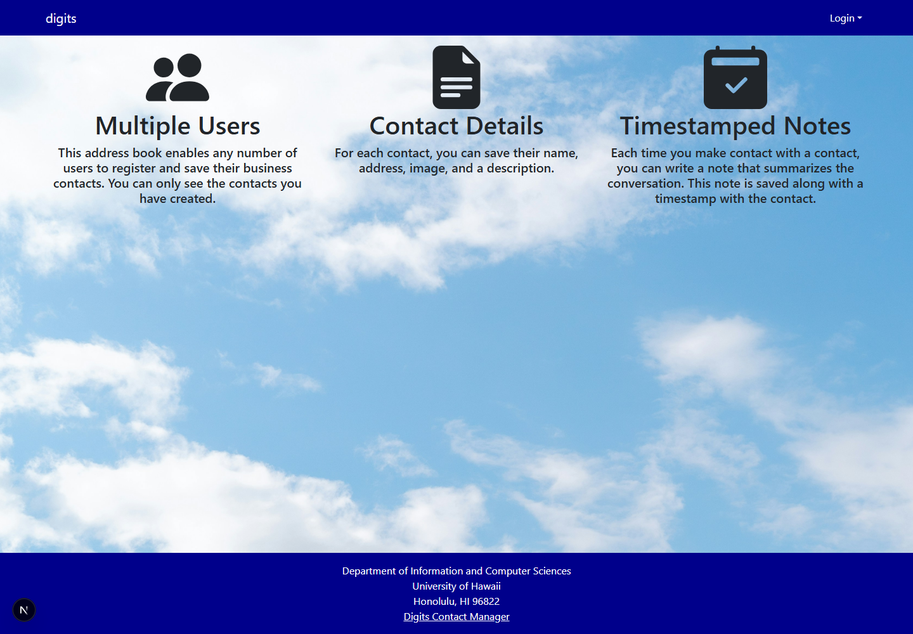

# Digits Contact Manager

Digits is a contact manager for keeping personal contact details and timestamped notes. Each account sees its own contacts; administrators can review all contacts and registered users.

## Installation

### Requirements

- Node.js and npm
- PostgreSQL

### Setup

1. Install dependencies:

   ```sh
   npm install
   ```

2. Create a PostgreSQL database (the example uses `digits`):

   ```sh
   createdb digits
   ```

3. Copy `sample.env` to `.env` and set `DATABASE_URL` to connect to the database. Set `AUTH_SECRET` to a private random value and keep `.env` out of source control.

4. Create the database tables and seed the sample accounts and contacts:

   ```sh
   npx prisma migrate dev
   npm run seed
   ```

   The development seed includes `john@foo.com` and `admin@foo.com`; both use the password `changeme`.

5. Start the development server:

   ```sh
   npm run dev
   ```

   Open [http://localhost:3000](http://localhost:3000).

## Pages

- **Home (`/`)** — introduces Digits and its contact-management features.
- **Sign in (`/auth/signin`)** — authenticate with an existing account.
- **Sign up (`/auth/signup`)** — register an account.
- **Add Contact (`/add`)** — save a contact's name, address, image, and description.
- **List Contacts (`/list`)** — view and edit your contacts, add timestamped notes, and review each contact's notes.
- **Edit Contact (`/edit/contact/[id]`)** — update a contact's details.
- **Admin (`/admin`)** — administrators can review all contacts and registered users.
- **Change Password (`/auth/change-password`)** — update the password for the signed-in account.
- **Sign out (`/auth/signout`)** — end the current session.
- **Not authorized (`/not-authorized`)** — shown when an account lacks permission for a restricted page.

## Development

- Run ESLint with `npm run lint`.
- Run the end-to-end browser tests with `npm run playwright`.
- Apply future Prisma schema changes with `npx prisma migrate dev`.
